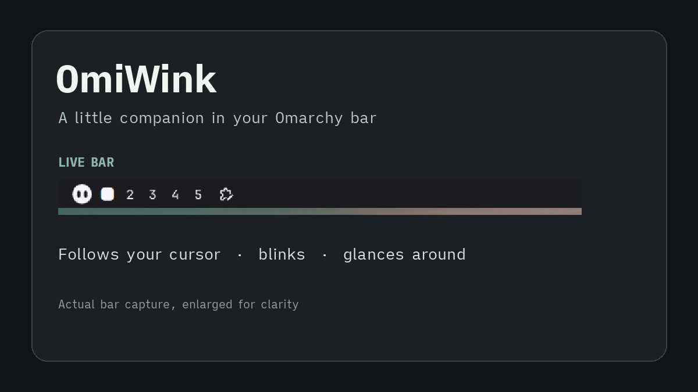

# OmiWink

OmiWink is a small companion for your Omarchy bar. Its eyes follow your mouse as you work, then blink, wink and look around when you pause. Its idle actions vary in timing and finish before mouse tracking resumes.



## In your daily workflow

OmiWink sits alongside your other bar widgets while you browse, write or code. It adds a little character to the desktop without opening a window. Its colors follow your bar theme.


The screenshots show the same face running in a customized menu widget; the standalone OmiWink plugin uses the same face and animation code.

## Install

OmiWink requires Omarchy's Quattro shell, Hyprland, and Python 3. Install it with:

```sh
omarchy plugin add https://github.com/anugrahvibi/OmiWink.git --enable
```

To remove it, disable and remove the plugin:

```sh
omarchy plugin disable anugrahvibi.omiwink
omarchy plugin remove anugrahvibi.omiwink
```

OmiWink adds no services, packages, or privileged commands. Removing the plugin removes its files.

## How it works

The bar widget runs one small Python process on the primary display. It reads cursor coordinates from the current Hyprland session's local IPC socket and sends them to the QML face. It samples at 8 Hz while idle and up to 60 Hz briefly after pointer movement. Omarchy's idle monitor pauses the reader when the session is idle. The plugin does not send data over the network or store cursor history.

Omarchy plugins run with your user permissions and are not sandboxed. OmiWink uses the Omarchy shell APIs and the current user's Hyprland IPC socket. It does not request elevated privileges.

## License

OmiWink is licensed under the MIT License. See [LICENSE](LICENSE).

## Validate

Run these commands from the repository root on Omarchy:

```sh
omarchy plugin validate .
qmllint -I "$OMARCHY_PATH/shell" OmiWinkBarWidget.qml OmiWinkFace.qml OmiWinkMotion.qml
```
